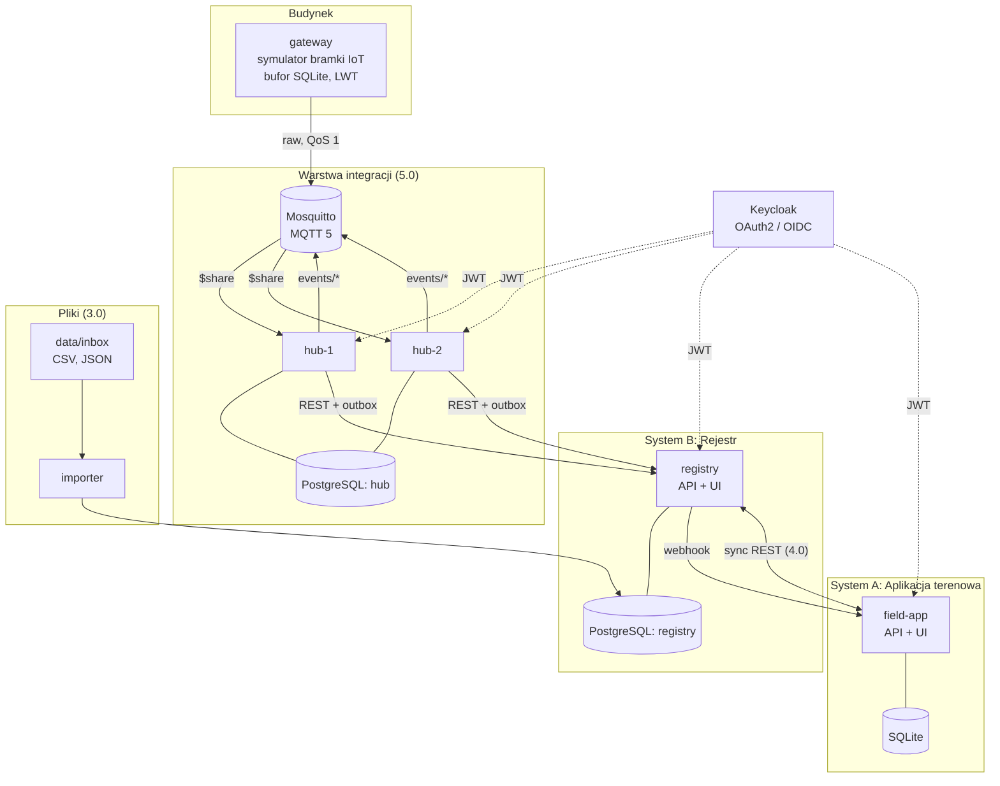
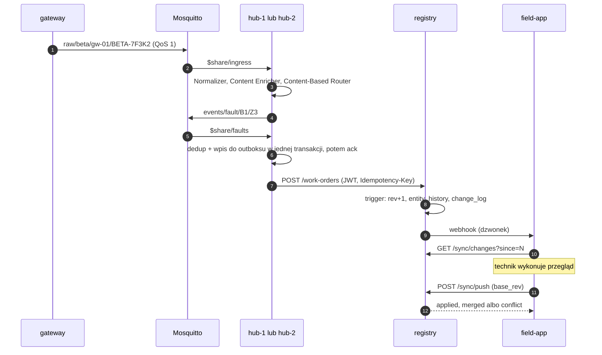

# Vigiles - plan projektu

Zaliczenie warsztatu z przedmiotu Integracja systemów informatycznych. Nazwa od *vigiles*, straży pożarnej i nocnej starożytnego Rzymu, powołanej przez Augusta w 6 r. n.e.

> **Dla Claude Code:** przeczytaj cały dokument przed pierwszą zmianą w kodzie. Kamienie milowe realizuj po kolei (sekcja 13). Decyzji z sekcji 2 nie zmieniaj bez pytania. Granice zakresu: sekcja 17. Pułapki: sekcja 18 - wróć do niej przed każdym kamieniem.

---

## 1. Co budujemy

Platformę nadzoru i utrzymania zabezpieczeń przeciwpożarowych budynku:

- wykonawca dostarcza zestawienie zamontowanych elementów (przejścia instalacyjne, drzwi i klapy ppoż., czujki) w CSV, a konfigurację obiektu (strefy, urządzenia) w JSON - importer ładuje je do **Rejestru** (System B),
- kierownik w Rejestrze zleca przeglądy, technik wykonuje je w **Aplikacji terenowej** (System A), wyniki wracają do Rejestru,
- urządzenia w budynku przez **bramkę IoT** wysyłają alarmy, usterki i telemetrię do brokera **MQTT**, a **hub integracyjny** je normalizuje, wzbogaca, routuje, agreguje i sam zakłada w Rejestrze zlecenia, które trafiają do technika.

Każdy próg oceny to kolejny styl integracji z G. Hohpe, B. Woolf, *Enterprise Integration Patterns* (rozdz. 2):

| Ocena | Styl integracji | Co dochodzi |
|---|---|---|
| 3.0 | File Transfer | importer CSV/JSON -> PostgreSQL |
| 4.0 | Remote Procedure Invocation (REST) | dwukierunkowa synchronizacja Rejestr <-> Aplikacja terenowa |
| 5.0 | Messaging | MQTT, hub z wzorcami EIP, Keycloak, odporność na awarie |

Czwarty styl, Shared Database, świadomie pomijamy między A i B (ADR-007).

Zasoby, które systemy sobie udostępniają (karta przedmiotu: "pliki lub urządzenia", "synchronizacji z bazą danych"): pliki (`data/inbox`), bazy danych (PostgreSQL Rejestru i huba, SQLite aplikacji terenowej), urządzenia (bramka IoT).

System jest warstwą nadzoru i utrzymania. Nie zastępuje certyfikowanej centrali sygnalizacji pożarowej - w realnym budynku alarmy obsługuje centrala zgodna z EN 54-2, a koincydencja w hubie demonstruje wzorzec Aggregator. Napisz to wprost w dokumentacji.

---

## 2. Decyzje (nie zmieniaj bez pytania)

1. **Stos:** Python 3.12, FastAPI, psycopg 3 z jawnym SQL (bez ORM), Pydantic v2, paho-mqtt 2.x, uv workspace. Kod synchroniczny (bez asyncio), wyjątek: endpoint SSE. Skalujemy replikami, nie współbieżnością w procesie.
2. **Broker:** Mosquitto, MQTT 5. MQTT jest standardem OASIS wymienionym w literaturze przedmiotu.
3. **Dostarczanie:** at-least-once + Idempotent Receiver na każdym etapie, co daje skutek "dokładnie raz". Każdy efekt uboczny opuszczający usługę idzie przez transakcyjny outbox.
4. **Synchronizacja A <-> B:** change feed + push z `base_rev` + scalanie trójstronne na poziomie pól + własność pól. Bez last-write-wins.
5. **Tożsamość:** Keycloak (OAuth2/OIDC) jako zewnętrzny IdP, RBAC egzekwowane w usługach. Bez własnego serwera OAuth2 - jedyny wyjątek to `dev-issuer` do testów i trybu lokalnego.
6. **Separacja:** A i B nie dzielą bazy ani modelu danych, integrują się wyłącznie przez kontrakt REST.
7. **Wersje:** tagi `v3.0`, `v4.0`, `v5.0`. Każdy tag to kompletna wersja do oddania na daną ocenę.

---

## 3. Macierz zgodności z wymaganiami

Przed każdym tagiem przejdź tę tabelę i sprawdź, że każdy wiersz ma działający dowód.

| Wymaganie | Realizacja | Gdzie | Dowód na filmie | Test |
|---|---|---|---|---|
| 3.0 / źródło i cel | CSV zestawienia elementów i JSON konfiguracji obiektu -> PostgreSQL Rejestru | `tools/importer` | plik z `data/inbox` pojawia się w Rejestrze | `tests/component/test_import.py` |
| 3.0 / mechanizm | `vigiles-import run <plik>` (ręcznie) i `vigiles-import watch` (polling co 10 s) | `tools/importer` | oba tryby | jw. |
| 3.0 / dokumentacja | `docs/import.md`, README | `docs/` | - | - |
| 3.0 / kryteria | UTF-8, UTF-8 z BOM, cp1250; separator `;` lub `,`; walidacja wierszy; raport odrzuconych; upsert w transakcji; baza niedostępna -> plik zostaje w `inbox` | `tools/importer` | plik z błędami -> `data/error/*.rejected.csv` | `tests/unit/test_csv.py` |
| 4.0 / A <-> B przez REST | Aplikacja terenowa pobiera change feed i wypycha zmiany, Rejestr dzwoni webhookiem | `services/registry`, `services/field_app` | zlecenie z Rejestru w kilka sekund u technika, wynik przeglądu wraca | `tests/e2e/test_sync.py` |
| 4.0 / spójność i konflikty | automatyczna propagacja, scalanie trójstronne, własność pól, kolejka konfliktów | `services/registry/.../sync` | równoległa edycja tego samego pola -> konflikt -> rozstrzygnięcie | `tests/component/test_conflicts.py` |
| 4.0 / uwierzytelnianie | v4.0: statyczne tokeny Bearer per usługa; od v5.0: JWT z Keycloak | `libs/common/auth` | żądanie bez tokenu -> 401 | `tests/component/test_auth.py` |
| 4.0 / logi i błędy | logi JSON z `correlation_id`, tabela `integration_events`, timeouty, retry, `422 application/problem+json` | wszystkie usługi | logi przefiltrowane po `correlation_id` | `tests/component/test_errors.py` |
| 5.0 / SOA i wzorce | usługi z kontraktami (OpenAPI, AsyncAPI); Content-Based Router, Aggregator i pozostałe z sekcji 9 | `services/hub` | MQTT Explorer: `raw/` -> `events/` | `tests/unit/test_router.py`, `tests/unit/test_aggregator.py` |
| 5.0 / buforowanie i retry | sesje trwałe MQTT, bufor store-and-forward w bramce, transakcyjny outbox z backoffem i jitterem | bramka, hub, Rejestr, aplikacja terenowa | zatrzymany Rejestr -> kolejka w outboksie -> opróżnienie po starcie | `tests/chaos/` |
| 5.0 / autoryzacja | Keycloak: client credentials (usługi), Authorization Code + PKCE (UI), RBAC, ACL brokera | `infra/keycloak`, `libs/common/auth` | technik nie rozstrzygnie konfliktu (403) | `tests/component/test_rbac_matrix.py` |
| 5.0 / min. 3 komponenty | bramka IoT, broker, hub x2, Rejestr, aplikacja terenowa, Keycloak, PostgreSQL | `compose.yaml` | `docker compose ps` | - |
| 5.0 / jakość, odporność, dokumentacja, testy | diagramy C4 w Mermaid, ADR, macierz awarii z wynikami testów | `docs/` | scenariusze awarii | `tests/e2e`, `tests/chaos` |

---

## 4. Architektura



Bazy `registry` i `hub` to jedna instancja PostgreSQL z osobnymi bazami i użytkownikami.

| Komponent | Rola | Technologia | Stan | Od |
|---|---|---|---|---|
| `importer` | ładuje CSV/JSON z `data/inbox` do bazy Rejestru | Python CLI | `import_runs` w bazie Rejestru | 3.0 |
| `registry` (System B) | rejestr elementów, zleceń, przeglądów, incydentów; arbiter konfliktów | FastAPI, UI: Jinja2 + htmx | PostgreSQL `registry` | 3.0 schemat, 4.0 API |
| `field-app` (System A) | aplikacja technika: zadania, przegląd, synchronizacja | FastAPI, UI: Jinja2 + htmx | SQLite (własna) | 4.0 |
| `mosquitto` | kanały, sesje trwałe, ACL | Mosquitto 2, MQTT 5 | wolumen z persystencją | 5.0 |
| `gateway` | symulator bramki: urządzenia dwóch fikcyjnych producentów, bufor store-and-forward, LWT, API scenariuszy | Python + paho | SQLite (bufor) | 5.0 |
| `hub-1`, `hub-2` | normalizacja, wzbogacanie, routing, agregacja, DLQ, outbox, konsola | FastAPI + paho | PostgreSQL `hub` | 5.0 |
| `keycloak` | IdP: OAuth2/OIDC, role | Keycloak, tryb dev | wolumen | 5.0 |
| `postgres` | bazy `registry` i `hub` | PostgreSQL 16 | wolumen | 3.0 |

Porty (te same lokalnie i w compose):

| Usługa | Port |
|---|---|
| registry | 8001 |
| field-app | 8002 |
| hub-1 / hub-2 | 8003 / 8004 |
| gateway (API scenariuszy, tylko localhost) | 8005 |
| dev-issuer (tylko tryb lokalny) | 8006 |
| keycloak | 8080 |
| mosquitto | 1883 |
| postgres | 5432 |

---

## 5. Scenariusze przepływu

To jednocześnie testy e2e i scenariusz filmu.

- **S1 Import (3.0).** Wykonawca przysyła `zestawienie_B1.csv` (cp1250, `;`). Importer waliduje i robi upsert, błędne wiersze trafiają do `data/error/zestawienie_B1.rejected.csv` z kolumną `powod`. Od 4.0 nowe elementy przez change feed docierają do aplikacji terenowej.
- **S2 Zlecenie przeglądu (4.0).** Kierownik zakłada w Rejestrze zlecenie przeglądu elementu `PI-B1-2-014` dla technika. Rejestr dzwoni webhookiem, aplikacja terenowa pobiera zmiany. Technik wpisuje wynik "do naprawy" z opisem. Wynik wraca: przegląd zapisany, stan elementu zmieniony, zlecenie zamknięte.
- **S3 Konflikt (4.0).** Technik włącza w aplikacji "pracuj offline" (realne: piwnice, szachty) i zmienia pole `notes`. W tym czasie kierownik zmienia to samo pole w Rejestrze. Po powrocie do sieci push kończy się konfliktem, kierownik rozstrzyga go w Rejestrze, wynik wraca do aplikacji. Równoległe zmiany różnych pól scalają się same.
- **S4 Usterka z urządzenia (5.0).** Sterownik klapy producenta Beta zgłasza zbyt długi czas zamykania. Hub normalizuje komunikat, uzupełnia strefę z katalogu urządzeń, kieruje go do kanału usterek i zakłada w Rejestrze zlecenie serwisowe, które przez S2 trafia do technika.
- **S5 Koincydencja alarmu (5.0).** Jedna czujka w strefie Z3 zgłasza alarm: po upływie okna powstaje incydent `alarm_wstepny`. Dwie różne czujki w oknie 60 s: incydent `alarm_potwierdzony`. Wzorowane na zależności od więcej niż jednego sygnału alarmowego z EN 54-2 (pkt 7.12).
- **S6 Telemetria (5.0).** Poziom zabrudzenia czujki przekracza próg -> zlecenie czyszczenia, bez duplikatu, gdy otwarte zlecenie już istnieje.
- **S7 Nieznane urządzenie (5.0).** Komunikat od urządzenia spoza katalogu trafia do Dead Letter Channel. Import poprawionego `site-config.json` (3.0) dodaje urządzenie, admin ponawia wiadomość z DLQ, hub ją przetwarza. Łączy import plików z obsługą błędów komunikatów.

Ścieżka S4 + S2:



---

## 6. Kontrakty

### 6.1 Rejestr (System B), prefiks `/api/v1`

| Metoda i ścieżka | Uprawnienie | Opis |
|---|---|---|
| `GET /devices` | `devices:read` | katalog urządzeń: `device_id`, `vendor`, `asset_code`, `site`, `zone` |
| `POST /work-orders` | `work-orders:create` | wymaga `Idempotency-Key`; gdy istnieje otwarte zlecenie dla (element, powód), zwraca je z `200` zamiast tworzyć duplikat |
| `POST /incidents` | `incidents:create` | wymaga `Idempotency-Key` |
| `GET /sync/changes?since=&limit=` | `sync:read` | change feed (sekcja 8) |
| `POST /sync/push` | `sync:push` | partia zmian z `base_rev` (sekcja 8) |
| `GET /conflicts?status=open` | `conflicts:read` | otwarte konflikty |
| `POST /conflicts/{id}/resolve` | `conflicts:resolve` | wybór wartości dla pola |
| `GET /imports` | `imports:read` | historia importów |
| `GET /health/live`, `GET /health/ready` | publiczne | `ready` sprawdza bazę |

UI (sesja): elementy, zlecenia (tworzenie, przydział), konflikty, incydenty, importy.

### 6.2 Aplikacja terenowa (System A)

| Metoda i ścieżka | Uprawnienie | Opis |
|---|---|---|
| `POST /api/v1/webhooks/registry` | `webhook:notify` | dzwonek, body `{"latest_seq": 812}`, wyzwala natychmiastowy pull |
| `GET /api/v1/sync/status` | `tasks:read` | oczekujące zmiany, ostatnia synchronizacja, konflikty |
| `POST /api/v1/sync/offline` | `inspections:write` | przełącznik "pracuj offline" |
| `GET /health/live`, `GET /health/ready` | publiczne | |

UI: lista zadań, formularz przeglądu, plakietka "w konflikcie", status synchronizacji.

### 6.3 Hub i bramka

Hub:

| Metoda i ścieżka | Uprawnienie | Opis |
|---|---|---|
| `GET /api/v1/events/stream` | `console:read` | SSE: zdarzenia integracyjne na żywo (Wire Tap) |
| `GET /api/v1/dead-letters` | `dlq:read` | |
| `POST /api/v1/dead-letters/{id}/replay` | `dlq:replay` | uruchamia potok ingress w procesie na zapisanym surowym komunikacie |
| `GET /api/v1/outbox?status=` | `console:read` | |

Do tego `GET /health/live` i `GET /health/ready` jak w pozostałych usługach. Konsola: jedna strona HTML z listą zdarzeń na żywo, DLQ i stanem outboksu.

Bramka (tylko localhost, klucz API w nagłówku `X-Api-Key`):

| Metoda i ścieżka | Body |
|---|---|
| `POST /scenario/alarm` | `{"zone": "Z3", "detectors": 2, "interval_s": 10}` |
| `POST /scenario/damper-fault` | `{"device_id": "BETA-7F3K2", "closing_time_s": 95.2}` |
| `POST /scenario/contamination` | `{"device_id": "A-000124", "value": 85}` |
| `POST /scenario/unknown-device` | `{}` |
| `POST /scenario/burst` | `{"count": 200}` |
| `GET /buffer` | liczba wiadomości w buforze |

### 6.4 Tematy MQTT

QoS 1 wszędzie poza podglądem.

| Temat | Publikuje | Subskrybuje |
|---|---|---|
| `vigiles/raw/{vendor}/{gateway}/{device}` | bramka | hub: `$share/ingress/vigiles/raw/#` |
| `vigiles/status/{gateway}` (retained, LWT `offline`) | bramka | hub: `$share/ingress/vigiles/status/+` |
| `vigiles/events/alarm/{site}/{zone}` | hub (router) | hub: `$share/aggregator/vigiles/events/alarm/#` |
| `vigiles/events/fault/{site}/{zone}` | hub (router) | hub: `$share/faults/vigiles/events/fault/#` |
| `vigiles/events/telemetry/{site}/{zone}` | hub (router) | hub: `$share/telemetry/vigiles/events/telemetry/#` |
| `vigiles/dlq/{reason}` | hub | podgląd; źródłem prawdy jest tabela `dead_letters` |
| `vigiles/#` | - | konsola huba i MQTT Explorer (QoS 0, bez sesji) |

Każdy konsument (ingress, aggregator, faults, telemetry) to osobne połączenie z własnym, stałym `client_id`: `hub-1-ingress`, `hub-1-aggregator` itd.

### 6.5 Koperta kanoniczna (Canonical Data Model)

```json
{
  "schema_version": 1,
  "message_id": "7c0e6b1e-2f7a-5b8e-9d41-0e2a6c1f9b33",
  "correlation_id": "7c0e6b1e-2f7a-5b8e-9d41-0e2a6c1f9b33",
  "type": "fault",
  "site": "B1",
  "zone": "Z3",
  "device_id": "BETA-7F3K2",
  "asset_code": "KL-B1-3-002",
  "vendor": "beta",
  "occurred_at": "2026-11-04T10:15:00Z",
  "normalized_at": "2026-11-04T10:15:00.412Z",
  "payload": {"code": "DAMPER_SLOW_CLOSE", "closing_time_s": 95.2}
}
```

`message_id` jest deterministyczny: UUIDv5 z (vendor, device_id, identyfikator producenta). Gdy producent nie podaje identyfikatora (Beta), z (vendor, device_id, czas, typ, kod). Ta sama wiadomość dostarczona ponownie ma ten sam `message_id`. Kolizja jest możliwa tylko dla identycznych zdarzeń z tej samej sekundy - akceptujemy i opisujemy.

### 6.6 Formaty producentów

Nazwy Alfa i Beta są fikcyjne.

Alfa - płaski JSON, czas w ms od epoki, kody wielkimi literami, strefa w komunikacie:

```json
{"id": 88121, "dev": "A-000123", "evt": "ALARM", "ts": 1793787300123, "zone": "Z3"}
{"id": 88140, "dev": "A-000124", "evt": "TLM", "ts": 1793787360000, "contamination": 85}
```

Beta - zagnieżdżony, ISO 8601 z przesunięciem strefy czasowej, przecinek dziesiętny, bez strefy budynku i bez identyfikatora wiadomości:

```json
{"serial": "BETA-7F3K2", "time": "2026-11-04T11:15:00+01:00",
 "event": {"type": "fault", "code": "DAMPER_SLOW_CLOSE", "measured": "95,2", "unit": "s"}}
```

### 6.7 Wspólne nagłówki i błędy

- `Authorization: Bearer <token>`
- `X-Correlation-ID` - przyjmowany albo generowany przez middleware, przekazywany dalej: HTTP, koperta MQTT, outbox, kolumna `correlation_id` w zleceniu
- `Idempotency-Key` - dla operacji tworzących wywoływanych przez usługi (ta sama konwencja co np. w API Stripe)
- błędy: `application/problem+json` (RFC 9457); `503` z `Retry-After`, gdy baza niedostępna

---

## 7. Model danych

### 7.1 Rejestr (PostgreSQL, baza `registry`)

- `sites(id, code, name, address)`
- `zones(id, site_id, code, name, floor)`
- `assets(id uuid, code unique, asset_type, site_id, zone_id, building, floor, room, partition, installation, diameter_mm, seal_system, fire_rating, installed_at, installer, condition, last_inspected_at, next_inspection_due, notes, rev, updated_at, updated_by, origin)`
  - `asset_type`: `przejscie_instalacyjne`, `drzwi_ppoz`, `klapa_ppoz`, `czujka_dymu`
  - `condition`: `sprawny`, `do_naprawy`, `niesprawny`, `wycofany` (bez twardego usuwania)
  - `fire_rating`: `EI <minuty>`, walidacja klas czasowych `15, 20, 30, 45, 60, 90, 120, 180, 240` (lista do potwierdzenia przez autora projektu)
- `devices(device_id pk, vendor, asset_id, gateway_id)`
- `work_orders(id uuid, asset_id, reason, status, assigned_to, due_date, source, correlation_id, rev, ...)`
  - `reason`: `przeglad_okresowy`, `usterka_urzadzenia`, `czyszczenie`, `brak_lacznosci`
  - `status`: `nowe`, `przydzielone`, `w_realizacji`, `zakonczone`, `anulowane`
- `inspections(id uuid nadawany przez klienta, work_order_id, asset_id, technician, performed_at, result, findings, rev)`
- `incidents(id, kind, site, zone, detectors text[], first_at, decided_at, correlation_id, status)`, `kind`: `alarm_potwierdzony`, `alarm_wstepny`
- `entity_history(entity, entity_id, rev, data jsonb, origin, changed_at)` - baza scalania trójstronnego i ślad audytowy
- `change_log(seq bigserial, entity, entity_id, rev, op, origin, changed_at)`
- `conflicts(id, entity, entity_id, field, base_value, server_value, client_value, client_change_id, status, resolved_by, resolved_value, created_at, resolved_at)`
- `applied_changes(change_id pk, result jsonb)` - idempotencja pusha
- `idempotency_keys(key pk, client_id, status_code, response jsonb, created_at)`
- `import_runs(id, file_name, sha256 unique, format, rows_total, rows_ok, rows_rejected, status, started_at, finished_at, error)`
- `integration_events(id, ts, service, event, correlation_id, outcome, details jsonb)`
- `outbox(...)` - webhooki do aplikacji terenowej, struktura jak w hubie (7.3)

Triggery na `assets`, `work_orders`, `inspections`: `rev` + 1, wpis do `entity_history` i `change_log`. `origin` z `current_setting('vigiles.origin', true)`, ustawianego przez `SET LOCAL` w każdej transakcji (identyfikator klienta z tokenu albo `importer`).

Migracje: numerowane pliki SQL + mały runner z tabelą `schema_migrations`.

### 7.2 Aplikacja terenowa (SQLite) - celowo inny model

- `tasks(id = work_order_id, asset_id, title, reason, status, due_date, assigned_to, server_rev)`, `status`: `NEW`, `ASSIGNED`, `IN_PROGRESS`, `DONE`, `CANCELLED`
- `assets(id, code, label, condition, notes, server_rev)`, `condition`: `OK`, `NEEDS_REPAIR`, `FAILED`, `RETIRED`; `label` to złożony opis lokalizacji, tylko do odczytu
- `inspections(id uuid, task_id, result, findings, performed_at)`
- `pending_changes(change_id uuid, entity, entity_id, base_rev, patch json, status, attempts, next_attempt_at, last_error, conflict_id, created_at)` - outbox aplikacji, `status`: `pending`, `sent`, `conflict`, `rejected`
- `sync_state(key, value)` - m.in. kursor `registry_since`, flaga offline
- `sync_log(id, ts, direction, outcome, details)`

Message Translator (`field_app/sync/translator.py`):

| Rejestr | Aplikacja terenowa |
|---|---|
| `condition`: `sprawny`, `do_naprawy`, `niesprawny`, `wycofany` | `OK`, `NEEDS_REPAIR`, `FAILED`, `RETIRED` |
| `work_orders.status`: `nowe`, `przydzielone`, `w_realizacji`, `zakonczone`, `anulowane` | `NEW`, `ASSIGNED`, `IN_PROGRESS`, `DONE`, `CANCELLED` |
| `building`, `floor`, `room`, `partition` | `label` (tylko odczyt) |
| `rev` | `server_rev` |

### 7.3 Hub (PostgreSQL, baza `hub`)

- `processed_messages(consumer, message_id, processed_at, primary key (consumer, message_id))`
- `alarm_windows(id, site, zone, opened_at, closes_at, detectors text[], status, decided_at)`, `status`: `open`, `confirmed`, `expired`; częściowy unikalny indeks na `(site, zone) where status = 'open'`
- `outbox(id, message_id unique, method, target_url, payload jsonb, headers jsonb, status, attempts, next_attempt_at, locked_by, locked_until, last_error, correlation_id, created_at, sent_at)`, `status`: `pending`, `sent`, `dead`
- `dead_letters(id, dedup_key unique, message_id, source_topic, reason, raw_payload text, error, created_at, replayed_at)`; `dedup_key` to `message_id` albo SHA-256 surowego komunikatu, gdy nie da się go sparsować
- `integration_events(id, ts, instance, stage, event, message_id, correlation_id, outcome, details jsonb)`

### 7.4 Pliki wejściowe

`data/samples/zestawienie_B1.csv` (cp1250, `;`, nagłówki jak z Excela wykonawcy):

```
Nr elementu;Typ;Budynek;Kondygnacja;Pomieszczenie;Przegroda;Instalacja;Średnica [mm];System uszczelnienia;Klasa EI;Data montażu;Brygada;Uwagi
PI-B1-2-014;przejście instalacyjne;B1;2;2.14;ściana;rura PVC;110;kołnierz ogniochronny;EI 60;14.03.2025;B-2;
```

`data/samples/zestawienie_B1_bledy.csv` - celowo błędne wiersze: brak numeru, zdublowany numer, `EI 75`, data montażu w przyszłości, numer zamieniony przez Excela na `1,23E+11`, średnica `sto`.

Mapowanie nagłówków odporne na wielkość liter, spacje i polskie znaki, z listą aliasów. Importer nie dotyka pól terenowych (`condition`, `last_inspected_at`).

`data/samples/site-config.json`:

```json
{
  "site": {"code": "B1", "name": "Budynek biurowy B1", "address": "ul. Przykładowa 1"},
  "zones": [{"code": "Z3", "name": "Piętro 3, skrzydło A", "floor": 3}],
  "devices": [
    {"device_id": "A-000123", "vendor": "alfa", "asset_code": "CZ-B1-3-001", "zone": "Z3", "gateway": "gw-01"},
    {"device_id": "A-000124", "vendor": "alfa", "asset_code": "CZ-B1-3-002", "zone": "Z3", "gateway": "gw-01"},
    {"device_id": "BETA-7F3K2", "vendor": "beta", "asset_code": "KL-B1-3-002", "zone": "Z3", "gateway": "gw-01"}
  ]
}
```

Ten sam plik czyta bramka, żeby wiedzieć, co symulować - jedno źródło danych demo.

---

## 8. Protokół synchronizacji (4.0)

**Pull** - `GET /api/v1/sync/changes?since=812&limit=500`:

```json
{"changes": [{"seq": 813, "entity": "work_order", "id": "…", "rev": 3, "op": "update", "data": {}}],
 "next_since": 813, "has_more": false}
```

`data` to bieżący stan encji. Klient bierze najwyższy `rev` per encję i pomija `rev <= server_rev` - to blokuje pętlę echa (własna zmiana wraca w feedzie z `rev`, który klient zna już z odpowiedzi na push).

**Push** - `POST /api/v1/sync/push`:

```json
{"changes": [{"change_id": "…", "entity": "asset", "id": "…", "base_rev": 7,
  "patch": {"condition": "do_naprawy", "notes": "pęknięta masa uszczelniająca"}}]}
```

`patch` jest w modelu Rejestru (tłumaczy aplikacja terenowa). Wynik per zmiana: `applied {new_rev}`, `merged {new_rev, server_fields}`, `conflict {conflict_ids, new_rev?}`, `rejected {problem}`. Ponowienie tego samego `change_id` zwraca zapisany wynik z `applied_changes`.

**Algorytm w Rejestrze** (jedna transakcja, `SELECT ... FOR UPDATE` na encji):

1. `base = entity_history[base_rev]`, `current` = bieżący stan.
2. `server_changed` = pola, gdzie `current != base`; `client_changed` = pola z `patch`, gdzie `patch != base`.
3. `overlap` = część wspólna, z pominięciem pól, gdzie obie strony ustawiły tę samą wartość.
4. Dla pól z `overlap` decyduje własność: pole terenowe -> wygrywa klient; pole biurowe -> zostaje wartość serwera, odrzucenie jest logowane; pole wspólne -> wpis w `conflicts`.
5. Pozostałe pola z `patch` są stosowane, `rev` + 1 (jeśli cokolwiek zastosowano).

**Własność pól:**

| Właściciel | Pola |
|---|---|
| teren (technik) | `condition`, `last_inspected_at`, przeglądy, status zlecenia `w_realizacji` i `zakonczone` |
| biuro (kierownik, importer) | `code`, `asset_type`, lokalizacja, `fire_rating`, `seal_system`, `installed_at`, `installer`, `next_inspection_due`, przydział i termin zlecenia |
| wspólne (konflikt) | `notes` |

**Przykład:**

| Krok | Kto | Zmiana | rev po kroku | Wynik |
|---|---|---|---|---|
| 1 | - | stan wyjściowy | 7 | |
| 2 | biuro | `room: 2.14 -> 2.14A` | 8 | |
| 3 | teren, `base_rev 7` | `condition -> do_naprawy`, `notes -> "pęknięta masa"` | 9 | `merged`: pola rozłączne |
| 4 | biuro | `notes -> "do weryfikacji"` | 10 | |
| 5 | teren, `base_rev 9` | `notes -> "masa wymieniona"` | 10 | `conflict` na `notes` |

**Rozstrzygnięcie:** kierownik wybiera wartość serwera, klienta albo własną. Zapis idzie jak zwykła zmiana biurowa, a encja `conflict` jest w change feedzie, więc aplikacja terenowa dostaje nowy stan i zdejmuje plakietkę.

**Zlecenia:** B -> A utworzenie, przydział, anulowanie; A -> B `w_realizacji`, `zakonczone` + przegląd. Przeglądy mają UUID nadawany w aplikacji terenowej, więc nie ma mapowania identyfikatorów.

**Dzwonek:** notifier w Rejestrze co 2 s porównuje `max(change_log.seq)` z ostatnio zgłoszonym i dodaje webhook do outboksu. Obejmuje też zmiany z importera, który pisze bezpośrednio do bazy. Aplikacja terenowa i tak odpytuje co 30 s (rekonsyliacja), więc zgubiony dzwonek opóźnia, ale nie gubi danych.

---

## 9. Wzorce i miejsce w kodzie

Wymóg to minimum jeden wzorzec. Główne są Content-Based Router i Aggregator, pozostałe wynikają z potrzeb projektu - nie dorabiaj kolejnych na pokaz.

| Wzorzec | Źródło | Gdzie | Po co |
|---|---|---|---|
| Content-Based Router | EIP | `hub/ingress/router.py` | kanoniczny komunikat do kanału `alarm`, `fault` albo `telemetry` według `type`; nieznany typ -> DLQ. Reguły jako deklaratywna tabela |
| Aggregator | EIP | `hub/consumers/aggregator.py` | koincydencja: klucz korelacji (site, zone), warunek kompletności >= 2 różne czujki, timeout okna |
| Normalizer (Message Translator per producent) | EIP | `hub/ingress/translators/` | dwa formaty -> model kanoniczny |
| Canonical Data Model | EIP | `libs/common/.../envelope.py` | jedna koperta dla wszystkich konsumentów |
| Content Enricher | EIP | `hub/ingress/enricher.py` | strefa i kod elementu z katalogu urządzeń Rejestru (cache z TTL, przy awarii Rejestru stary cache) |
| Message Filter | EIP | `hub/consumers/telemetry.py` | tylko odczyty powyżej progu |
| Competing Consumers | EIP | subskrypcje `$share/...` | dwie repliki huba dzielą ruch |
| Idempotent Receiver | EIP | `processed_messages`, `applied_changes`, `idempotency_keys` | at-least-once bez podwójnych skutków |
| Dead Letter Channel | EIP | `dead_letters`, `vigiles/dlq/#` | komunikaty niepoprawne i niedostarczalne, z ponowieniem |
| Wire Tap | EIP | konsola huba (SSE), `integration_events` | podgląd przepływu bez wpływu na niego |
| Correlation Identifier | EIP | `correlation_id` | jedna ścieżka przez wszystkie usługi |
| Guaranteed Delivery | EIP | QoS 1, sesje trwałe, bufor bramki | brak utraty przy awarii odbiorcy |
| Channel Adapter | EIP | bramka | urządzenia -> MQTT |
| Polling Consumer | EIP | importer, change feed | |
| Transactional Outbox | microservices.io (C. Richardson) | hub, Rejestr, aplikacja terenowa | brak podwójnego zapisu baza + sieć |
| Retry z backoffem i jitterem | Cloud Design Patterns (Microsoft) | `libs/common/retry.py` | ponawianie przy niedostępności |

**Aggregator - reguły:**

- jedno otwarte okno na strefę (częściowy unikalny indeks); przy `unique_violation` ponów transakcję,
- zdarzenie pasuje do okna, gdy `|occurred_at - opened_at| <= W`, `W` = 60 s (konfigurowalne, wartość demonstracyjna),
- >= 2 różne czujki -> `confirmed`, wpis do outboksu: `POST /incidents` z `kind = alarm_potwierdzony`,
- sweeper w każdej replice co 5 s: okna `open` po `closes_at + L` (tolerancja spóźnień, 10 s) -> `expired` -> `alarm_wstepny`; wybór wierszy przez `FOR UPDATE SKIP LOCKED`,
- `Idempotency-Key` incydentu = identyfikator okna + wynik,
- okno liczone po czasie zdarzenia (`occurred_at`), nie po czasie przyjścia.

**Progi** (konfigurowalne, wartości demonstracyjne, nie normowe): czas zamykania klapy > 60 s -> usterka; zabrudzenie czujki >= 80% -> czyszczenie.

---

## 10. Niezawodność

### 10.1 Buforowanie na trzech poziomach

1. **Bramka:** każda wiadomość najpierw do SQLite, usuwana po PUBACK. Broker niedostępny -> bufor rośnie, reconnect z backoffem 1-30 s.
2. **Broker:** sesje trwałe (MQTT 5: `clean_start = False` i Session Expiry Interval > 0), QoS 1. Hub niedostępny -> broker kolejkuje.
3. **Usługi:** outbox zapisywany w tej samej transakcji co zmiana stanu. Relay rezerwuje wiersze dzierżawą (`FOR UPDATE SKIP LOCKED` + `locked_until`), wysyła poza transakcją, potem zapisuje wynik - kilka instancji nie wyśle tego samego, a padnięta instancja zwalnia wiersze po wygaśnięciu dzierżawy.

Ingress huba nie zapisuje stanu: publikuje komunikat kanoniczny, czeka na PUBACK (`wait_for_publish`) i dopiero wtedy potwierdza surową wiadomość. Po awarii między tymi krokami broker dostarczy ją ponownie, a deterministyczny `message_id` pozwoli konsumentom odrzucić duplikat.

### 10.2 Retry

Jedna implementacja w `libs/common/retry.py`:

- opóźnienie `random(0, min(cap, base * 2**attempt))` (full jitter), `base` 1 s, `cap` 30 s (wartości pod demo); dłuższy `Retry-After` ma pierwszeństwo,
- ponawiane: błąd połączenia, timeout, 5xx, 429, 401 (raz, po odświeżeniu tokenu),
- nieponawiane: 400, 403, 404, 409, 422 -> od razu DLQ z powodem,
- po 15 próbach `dead` + wpis w DLQ, możliwy ręczny replay,
- zegar i generator losowy wstrzykiwane, więc testy są deterministyczne.

### 10.3 Macierz awarii

Każdy wiersz to test w `tests/chaos/`. Wyniki przebiegu wklej do `docs/resilience.md`.

| # | Węzeł | Akcja | Oczekiwane | Mechanizm |
|---|---|---|---|---|
| C1 | registry | stop na 60 s; w tym czasie 5 usterek z urządzeń i 3 przeglądy z terenu | outbox huba i `pending_changes` rosną; po starcie wszystko dociera, zero duplikatów | outbox, retry, `Idempotency-Key`, `applied_changes` |
| C2 | hub-1 | kill w trakcie serii 200 wiadomości | hub-2 obsługuje nowe; wiadomości w locie hub-1 dochodzą po jego restarcie; 200 skutków, zero duplikatów | `$share`, sesja trwała, ack po commicie, Idempotent Receiver |
| C3 | mosquitto | stop na 60 s | bramka buforuje i po starcie wysyła zaległe; hub przetwarza wszystko | store-and-forward, reconnect |
| C4 | field-app | stop; kierownik tworzy 3 zlecenia | webhooki czekają w outboksie Rejestru; po starcie pull od kursora daje 3 zadania | kursor change feedu, retry webhooków |
| C5 | postgres | stop na 30 s przy ruchu z urządzeń | hub nie potwierdza wiadomości, broker je trzyma; Rejestr zwraca 503 z `Retry-After`; aplikacja terenowa działa dalej na SQLite; po starcie wszystko przetworzone | ack po commicie, readiness, osobna baza A |
| C6 | keycloak | stop na 60 s | wywołania z ważnym tokenem działają (JWKS i tokeny w cache); logowanie do UI niedostępne; po starcie normalnie | cache JWKS i tokenów |
| C7 | gateway | kill (SIGKILL) | broker publikuje LWT `offline`, hub zakłada zlecenie `brak_lacznosci` | MQTT Last Will |

### 10.4 Znane ograniczenia

Opisz je w `docs/resilience.md` wprost, zamiast obiecywać pełną niezawodność:

- PostgreSQL to pojedyncza instancja: jego awaria wstrzymuje przetwarzanie bez utraty danych (C5); replikacja poza zakresem.
- Mosquitto zapisuje stan na dysk okresowo i przy zamknięciu. Przy twardym zabiciu brokera wiadomości przyjęte od ostatniego zapisu mogą przepaść. Ustaw częsty autosave, sprawdź zachowanie w przypiętej wersji i opisz wynik.
- `$share` z QoS 1 nie gwarantuje globalnej kolejności - stąd agregacja po czasie zdarzenia.
- Specyfikacja MQTT 5 pozwala brokerowi przy zerwanym połączeniu członka grupy `$share` albo czekać na jego powrót, albo przekazać wiadomość innemu członkowi. Test C2 musi przejść w obu wariantach - sprawdź, który realizuje Mosquitto, i opisz.
- Keycloak w trybie dev (wbudowana baza, jeden węzeł).

---

## 11. Bezpieczeństwo

### 11.1 Keycloak

Realm `vigiles`, import z `infra/keycloak/realm.json` generowanego z szablonu (11.4).

| Klient | Typ | Przepływ | Do czego |
|---|---|---|---|
| `registry-ui`, `field-app-ui`, `hub-console` | confidential | Authorization Code + PKCE | logowanie ludzi (Authlib) |
| `svc-hub` | service account | client credentials | hub -> Rejestr |
| `svc-field-app` | service account | client credentials | aplikacja terenowa -> Rejestr |
| `svc-registry` | service account | client credentials | Rejestr -> aplikacja terenowa (webhook) |

API każdej usługi to osobna audience: `registry-api`, `field-app-api`, `hub-api` - mapper Audience w klientach.

Użytkownicy demo: `jan.technik`, `anna.kierownik`, `zarzadca.b1`, `admin`.

### 11.2 Role i uprawnienia

Mapowanie w kodzie, egzekwowane zależnością FastAPI `require("...")`. Role z `realm_access.roles`.

| Rola | Uprawnienia |
|---|---|
| `technik` | `tasks:read`, `inspections:write` |
| `kierownik` | `assets:read`, `work-orders:create`, `work-orders:assign`, `conflicts:read`, `conflicts:resolve`, `incidents:read`, `imports:read`, `console:read` |
| `zarzadca` | `assets:read`, `incidents:read` |
| `admin` | wszystkie powyższe + `dlq:read`, `dlq:replay` |
| `svc-hub` | `devices:read`, `work-orders:create`, `incidents:create` |
| `svc-field-app` | `sync:read`, `sync:push` |
| `svc-registry` | `webhook:notify` |

### 11.3 Tryby uwierzytelniania (`AUTH_MODE`)

Jeden interfejs `TokenVerifier` / `TokenProvider`, zmiana trybu bez zmian w kodzie usług:

- `static` (v4.0): usługi - statyczne tokeny Bearer z `.env`; UI - wybór użytkownika z listy, oznaczony "tryb demonstracyjny",
- `oidc` (v5.0): Keycloak dla usług i UI,
- `dev` (tryb lokalny i testy): `tools/dev_issuer` podpisuje tokeny o tej samej strukturze co Keycloak; UI - wybór użytkownika. Nigdy w compose.

Walidacja JWT (`libs/common/auth/verifier.py`): tylko RS256 (odrzuć `none` i HS*), sprawdź `iss`, `aud`, `exp`, `nbf`, leeway 30 s, JWKS przez `PyJWKClient` z cache. Wydawca i adres JWKS konfigurowane osobno: `OIDC_ISSUER`, `OIDC_JWKS_URL` (pułapka 10).

### 11.4 Broker, bazy, sekrety

Mosquitto: `allow_anonymous false`, plik haseł tworzony przy starcie kontenera z `.env`, ACL:

```
user gw-01
topic write vigiles/raw/+/gw-01/#
topic write vigiles/status/gw-01

user hub
topic read vigiles/#
topic write vigiles/events/#
topic write vigiles/dlq/#

user explorer
topic read vigiles/#
```

Bazy: osobni użytkownicy z minimalnymi uprawnieniami - `importer` (tylko tabele importu i `import_runs`), `registry_app`, `hub_app`.

Sekrety: `scripts/gen_secrets.py` tworzy `.env` (losowe hasła i sekrety klientów) i renderuje `infra/keycloak/realm.json` z `realm.template.json`. W repo tylko `.env.example` i szablony.

---

## 12. Testy

| Poziom | Marker | Zakres | Wymaga |
|---|---|---|---|
| jednostkowe | `unit` | translatory producentów, router, agregator (wstrzyknięty zegar), scalanie trójstronne i własność pól, retry, parser CSV, translator A <-> B, walidacja JWT | nic |
| komponentowe | `component` | triggery i change feed, push/pull, idempotencja, outbox z serwerem zwracającym 503 i timeouty (`pytest-httpserver`), import do bazy, hub z prawdziwym Mosquitto, macierz RBAC (parametryzowana: rola x endpoint -> 200/401/403), ACL brokera | PostgreSQL 16, Mosquitto 2 |
| e2e | `e2e` | S1-S7 | cały stos |
| chaos | `chaos` | C1-C7 | cały stos + `NodeController` |

`tests/harness/`:

- `eventually(fn, timeout=60, interval=0.5)` - asercje dla spójności osiąganej asynchronicznie,
- `NodeController` z backendami `compose` (`docker compose stop/kill/start`) i `local` (procesy z `scripts/supervisor.py`, PID-y w `.local/pids/`),
- klucze i tokeny z `tools/dev_issuer` dla testów RBAC.

---

## 13. Kamienie milowe

Szacunek względny: M2-M4 to około 80% pracy.

### M0 - szkielet

- uv workspace, `libs/common`: konfiguracja (pydantic-settings), logi JSON (structlog), middleware `X-Correlation-ID`, problem+json, health, `retry.py`
- `scripts/local_up.py`: instalacja i start PostgreSQL 16 i Mosquitto 2 z apt (idempotentnie), bazy i użytkownicy z `infra/postgres/init.sql`
- GitHub Actions: job `unit`
- **DoD:** `uv run pytest -m unit` zielone lokalnie i w CI

### M1 - ocena 3.0, tag `v3.0`

- schemat Rejestru (sites, zones, assets, devices, import_runs) + runner migracji
- importer: `run`, `watch`; CSV i JSON; walidacja Pydantic; upsert z `WHERE ... IS DISTINCT FROM`; SHA-256 pliku - ten sam plik drugi raz jest pomijany; `archive/`, `error/` z raportem
- dane przykładowe z sekcji 7.4
- `compose.yaml` z `postgres` i `importer`; `docs/import.md`; README
- **DoD:** plik -> dane w bazie; plik z błędami -> raport; baza wyłączona -> czytelny błąd, plik zostaje w `inbox` i wchodzi w następnym cyklu; `unit` i `component` zielone

### M2 - ocena 4.0, tag `v4.0`

- Rejestr: API, triggery historii i change feedu, push/pull, konflikty, idempotencja, notifier + outbox webhooków, UI (elementy, zlecenia, konflikty, importy)
- aplikacja terenowa: SQLite, translator, silnik synchronizacji (push, pull, kursor, retry, offline), odbiór webhooka, UI (zadania, przegląd, status)
- `AUTH_MODE=static`, logi JSON + `integration_events`, problem+json, timeouty i retry
- `docs/sync-protocol.md` z przykładem z sekcji 8
- **DoD:** S1-S3 jako e2e; C4 i wariant C1 bez huba jako chaos; zielone

### M3 - messaging (5.0, część 1)

- Mosquitto: persystencja, sesje, hasła, ACL
- bramka: urządzenia z `site-config.json`, dwa formaty, bufor SQLite, LWT, API scenariuszy
- hub: ingress (translatory, enricher, router, DLQ), konsumenci (agregator, usterki, telemetria), outbox z relay, idempotencja, `integration_events`, konsola SSE, dwie repliki
- **DoD:** S4-S7 jako e2e; C2, C3, C7 jako chaos

### M4 - tożsamość i odporność (5.0, część 2)

- Keycloak: szablon realmu, klienci, role, mappery Audience, użytkownicy demo; `scripts/gen_secrets.py`
- `AUTH_MODE=oidc`: `JwtVerifier`, `ClientCredentialsProvider` z cache tokenu, logowanie OIDC w trzech UI
- pełny `compose.yaml`: healthchecki, `restart: unless-stopped`, `depends_on` z `condition: service_healthy`
- C1, C5, C6; CI: job `e2e` na `docker compose up -d --build --wait`
- **DoD:** wszystkie testy zielone w CI

### M5 - dokumentacja i film, tag `v5.0`

- `docs/architecture.md`: diagram kontekstu i kontenerów C4 (Mermaid), diagramy sekwencji S2 i S4
- `docs/patterns.md`: tabela z sekcji 9 z linkami do plików
- `docs/resilience.md`: macierz z wynikami testów i znanymi ograniczeniami
- `docs/security.md`, `docs/import.md`, `docs/sync-protocol.md`
- `docs/adr/`:
  - ADR-001 Python, FastAPI, jawny SQL
  - ADR-002 MQTT i Mosquitto zamiast AMQP i RabbitMQ
  - ADR-003 at-least-once + idempotencja zamiast exactly-once
  - ADR-004 scalanie trójstronne i własność pól zamiast last-write-wins
  - ADR-005 Keycloak i OAuth2/OIDC; dlaczego OAuth2, a nie SAML dla API
  - ADR-006 stan agregatora w PostgreSQL jako konsekwencja Competing Consumers
  - ADR-007 brak wspólnej bazy A i B
- `docs/api/*.json` (OpenAPI wyeksportowane skryptem), `docs/asyncapi.yaml` (kontrakt kanałów MQTT)
- `docs/runbook-windows.md`: Docker Desktop z WSL2, `python scripts/gen_secrets.py`, `docker compose up -d --build --wait`, adresy, użytkownicy demo
- film według sekcji 16, nagrany na PC

---

## 14. Środowiska

| | Sesja chmurowa (Claude Code) | PC z Windows | GitHub Actions |
|---|---|---|---|
| po co | kod, testy wszystkich poziomów w trybie lokalnym | całość do filmu | weryfikacja obrazów i compose |
| uruchomienie | `scripts/local_up.py` + `scripts/supervisor.py up` | `docker compose up -d --build --wait` | jw. |
| tożsamość | `AUTH_MODE=dev` | Keycloak | Keycloak |
| chaos | `NodeController(local)` | `NodeController(compose)` | `NodeController(compose)` |

**Stan sprawdzony 4.11.2026 w kontenerze chmurowym, w którym powstał ten plan** (Ubuntu 24.04). Sesja, w której będziesz budować, może mieć inne ustawienia sieci:

- Docker da się uruchomić (dockerd startuje), ale pobieranie obrazów z Docker Hub, quay.io i ghcr.io blokuje proxy (403). `docker compose up` i `docker build` (obrazy bazowe też są z Docker Hub) tam nie przejdą.
- apt działa: PostgreSQL 16 i Mosquitto 2.0.18 z repozytorium Ubuntu.
- PyPI i npm działają (htmx da się pobrać z npm); dostępne są uv, Node 22, Java.
- paho-mqtt 2.1.0 ma `manual_ack` i `Client.ack()`.

**Pierwszy krok agenta w sesji:** jeden `docker pull hello-world`. 403 -> tryb lokalny, bez ponawiania i bez prób obejścia proxy. Dockerfile i `compose.yaml` pisz normalnie - zweryfikuje je CI.

`scripts/supervisor.py`: `up`, `down`, `status`, `stop <węzeł>`, `start <węzeł>`, `kill <węzeł>`; definicje procesów w `local-nodes.yaml`, logi w `.local/logs/`.

---

## 15. Struktura repozytorium

```
vigiles/
  PLAN.md  CLAUDE.md  README.md
  pyproject.toml                 uv workspace
  compose.yaml  .env.example  .gitattributes
  .github/workflows/ci.yml
  libs/common/                   konfiguracja, logi, korelacja, problem+json, auth, retry, koperta
  services/
    registry/                    System B: api/ sync/ db/ ui/ outbox/ migrations/ Dockerfile
    field_app/                   System A: api/ sync/ db/ ui/ Dockerfile
    hub/                         ingress/ consumers/ outbox/ dlq/ console/ migrations/ Dockerfile
    gateway/                     vendors/ buffer.py scenarios.py Dockerfile
  tools/
    importer/
    dev_issuer/                  tylko tryb lokalny i testy
  infra/
    postgres/init.sql
    mosquitto/                   mosquitto.conf, acl, entrypoint tworzący plik haseł z .env
    keycloak/realm.template.json
  data/
    samples/                     zestawienie_B1.csv (cp1250), zestawienie_B1_bledy.csv, site-config.json
    inbox/  archive/  error/     zawartość w .gitignore
  scripts/                       local_up.py, supervisor.py, gen_secrets.py, export_openapi.py
  tests/                         unit/ component/ e2e/ chaos/ harness/
  docs/                          architecture, patterns, sync-protocol, resilience, security,
                                 import, adr/, api/, asyncapi.yaml, runbook-windows, video-script
```

---

## 16. Scenariusz filmu (ok. 5 min)

Nagrywanie: OBS Studio. Podgląd tematów: MQTT Explorer (użytkownik `explorer`). Oba darmowe.

| Czas | Co | Jak |
|---|---|---|
| 0:00 | wszystkie serwisy działają | `docker compose ps` - wszystkie `healthy` |
| 0:20 | 3.0: import | `zestawienie_B1.csv` i plik z błędami do `data/inbox`; logi importera; dane w UI Rejestru; raport odrzuconych |
| 1:00 | 4.0: zlecenie | kierownik tworzy zlecenie -> po chwili u technika -> wynik przeglądu -> zlecenie zamknięte w Rejestrze |
| 1:50 | 4.0: konflikt | technik offline zmienia `notes`, kierownik też -> konflikt -> rozstrzygnięcie |
| 2:30 | 5.0: urządzenie -> zlecenie | `POST /scenario/damper-fault`; MQTT Explorer: `raw/beta/...` -> `events/fault/...`; zlecenie w Rejestrze i u technika |
| 3:00 | 5.0: koincydencja | jedna czujka -> alarm wstępny; dwie -> potwierdzony (konsola huba) |
| 3:20 | 5.0: awarie | `docker compose stop registry` + usterki -> outbox rośnie -> `start` -> opróżnia się; `docker compose kill hub-1` -> hub-2 przejmuje; `stop mosquitto` -> bufor bramki rośnie -> `start` |
| 4:20 | śledzenie | logi wszystkich usług przefiltrowane po jednym `correlation_id` - ścieżka bramka -> hub -> Rejestr -> aplikacja terenowa |
| 4:40 | RBAC | technik próbuje rozstrzygnąć konflikt -> 403 |

Filtrowanie logów w PowerShell:

```powershell
docker compose logs --no-log-prefix | Select-String "<correlation_id>"
```

---

## 17. Poza zakresem

Nie podnosi oceny, zwiększa ryzyko:

- Kubernetes, Kafka, RabbitMQ (jest MQTT), Prometheus, Grafana
- SPA w React czy Vue - wystarczą szablony i htmx
- replikacja PostgreSQL, klaster brokera
- prawdziwe protokoły central sygnalizacji pożarowej (ESPA 4.4.4, BACnet, Modbus) - bramka jest symulatorem
- zdjęcia w przeglądach, aplikacja mobilna, wiele obiektów i najemców
- TLS w wewnętrznej sieci compose (na sam koniec, jeśli zostanie czas: TLS na listenerze MQTT)
- własny serwer OAuth2 (poza `dev_issuer` do testów)

---

## 18. Pułapki

1. **Pętla echa** w synchronizacji dwukierunkowej: własna zmiana wraca w change feedzie. Klient pomija `rev <= server_rev`.
2. **Ponowny import** nie może podbijać `rev`: upsert z `WHERE (...) IS DISTINCT FROM EXCLUDED`.
3. **Podwójny zapis** (baza + sieć): nigdy "commit, potem wyślij". Zawsze outbox.
4. **`message_id` deterministyczny** (UUIDv5), inaczej ponowne dostarczenie wygląda jak nowa wiadomość.
5. **Stały `client_id` per połączenie** (`hub-1-ingress`, `hub-2-ingress` ...). Ten sam `client_id` w dwóch procesach = wzajemne wyrzucanie z sesji.
6. **MQTT 5 bez Session Expiry Interval > 0** kończy sesję przy rozłączeniu - broker niczego nie buforuje.
7. **Wątek sieciowy paho** nie może czekać na bazę: callback wrzuca wiadomość do kolejki, worker przetwarza i woła `client.ack(mid, qos)` po commicie. Ustaw Receive Maximum w CONNECT równe rozmiarowi kolejki - broker nie wyśle więcej niepotwierdzonych wiadomości, niż worker pomieści. Jeden worker na połączenie, potwierdzenia w kolejności odbioru (wymóg MQTT).
8. **Agregator przy dwóch replikach:** `$share` nie gwarantuje, że obie czujki z jednej strefy trafią do tej samej repliki. Stan w PostgreSQL, blokada wiersza, częściowy unikalny indeks na otwarte okno.
9. **LWT nie wychodzi przy łagodnym rozłączeniu.** W demo i teście C7: `docker compose kill gateway`, nie `stop`.
10. **Keycloak w Dockerze:** token wydany przeglądarce ma `iss` z adresem zewnętrznym (`localhost:8080`), a usługi w sieci compose widzą Keycloaka jako `keycloak:8080`. Ustaw stały hostname Keycloaka, a w usługach osobno `OIDC_ISSUER` (porównywany z `iss`) i `OIDC_JWKS_URL` (adres wewnętrzny).
11. **Audience:** bez mappera Audience Keycloak wystawia `aud: account` i walidacja `aud` odrzuci tokeny.
12. **Healthcheck Keycloaka:** obraz jest minimalny - sprawdź, czy ma `curl`; jeśli nie, `/dev/tcp` w bashu. Health jest na porcie zarządzania, osobnym od 8080.
13. **CSV z Excela:** cp1250, `;`, przecinek dziesiętny, daty `dd.mm.rrrr`, długie numery jako `1,23E+11` - nie do odzyskania, odrzuć z komunikatem.
14. **Testy spójności asynchronicznej:** zawsze `eventually(...)`, nigdy `sleep(5)`.
15. **Retry tylko dla błędów ponawialnych.** Błąd walidacji od razu do DLQ.
16. **htmx i CSS** wkopiowane do `static/` z npm, bez CDN.
17. **`.gitattributes`:** `*.sh text eol=lf`. Na Windowsie git potrafi zamienić końce linii na CRLF i entrypoint w kontenerze nie wystartuje.
