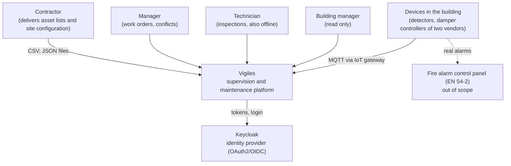
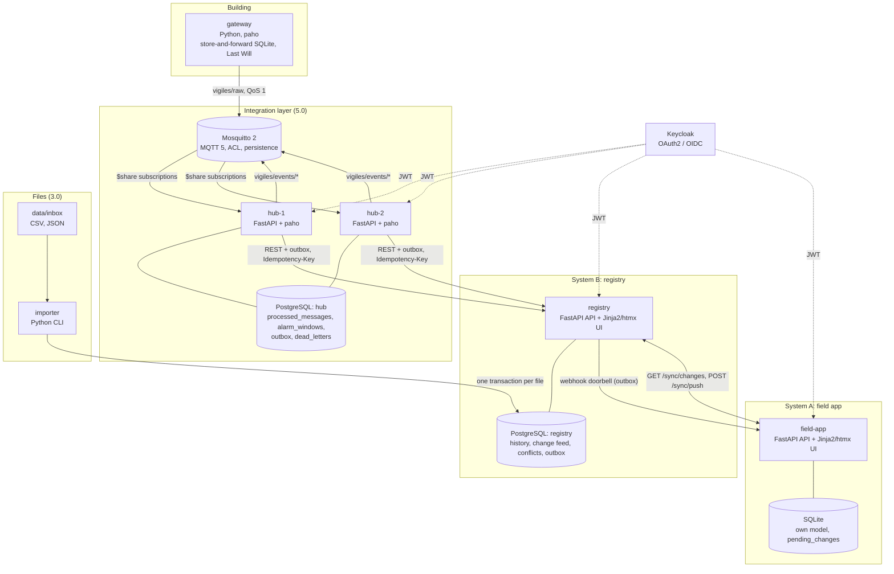
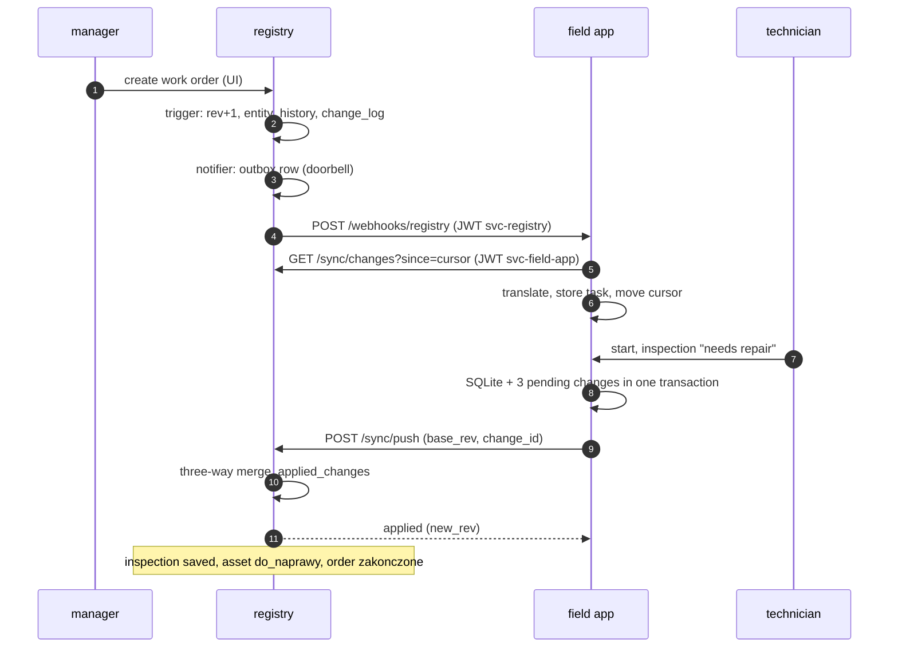
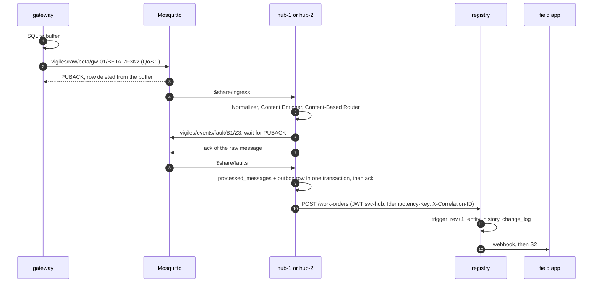

# Architecture

Vigiles supervises the fire protection of a building: fire stopping of
service penetrations, fire doors and dampers, smoke detectors. Every grade
of the course adds one integration style from Hohpe and Woolf,
*Enterprise Integration Patterns* (ch. 2):

| Grade | Style | Where |
|---|---|---|
| 3.0 | File Transfer | `tools/importer`: CSV/JSON from `data/inbox` -> PostgreSQL ([import.md](import.md)) |
| 4.0 | Remote Procedure Invocation | REST sync registry <-> field app ([sync-protocol.md](sync-protocol.md)) |
| 5.0 | Messaging | MQTT, integration hub with EIP patterns ([patterns.md](patterns.md)) |

Shared Database is deliberately not used between the two systems (ADR-007).

> Vigiles is a supervision and maintenance layer. It does not replace a
> certified fire alarm control panel: in a real building alarms are
> handled by a panel compliant with EN 54-2. The alarm coincidence in the
> hub demonstrates the Aggregator pattern.

## C4: system context



## C4: containers



| Container | Responsibility | State | Port |
|---|---|---|---|
| `importer` | loads files from `data/inbox` into the registry | `import_runs` | - |
| `registry` (System B) | assets, work orders, inspections, incidents; arbiter of conflicts | PostgreSQL `registry` | 8001 |
| `field-app` (System A) | technician app, offline work, sync engine | SQLite | 8002 |
| `mosquitto` | channels, durable sessions, ACL | volume | 1883 |
| `gateway` | simulated devices of vendors Alfa and Beta, buffer, Last Will, scenario API | SQLite buffer | 8005 (localhost) |
| `hub-1`, `hub-2` | normalise, enrich, route, aggregate, dead letters, outbox, console | PostgreSQL `hub` | 8003, 8004 |
| `keycloak` | identity provider | dev mode | 8080 |
| `postgres` | databases `registry` and `hub`, separate roles | volume | 5432 |

In local mode (no Docker) `tools/dev_issuer` (8006) stands in for
Keycloak and `scripts/supervisor.py` runs the same processes.

## Sequence S2: work order and inspection (4.0)



## Sequence S4: device fault to work order (5.0)



## Correlation

One `correlation_id` follows a flow: it is the `message_id` of the device
event, travels in the envelope, the outbox row (`X-Correlation-ID`), the
work order (`work_orders.correlation_id`) and the logs of every service:

```powershell
docker compose logs --no-log-prefix | Select-String "<correlation_id>"
```

## Technology

Python 3.12, FastAPI, psycopg 3 with explicit SQL, Pydantic v2, paho-mqtt
2.1, Mosquitto 2.0.18, PostgreSQL 16, Keycloak 26, uv workspace (ADR-001).
Code is synchronous; services scale by replicas.
