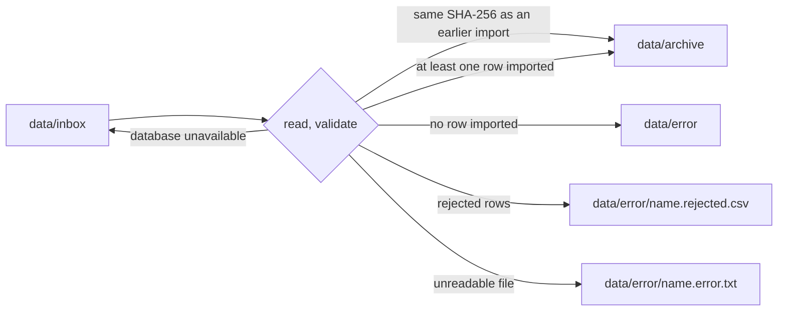

# File transfer: importer (grade 3.0)

The importer is a one-way integration of the **File Transfer** style
(Hohpe, Woolf, *Enterprise Integration Patterns*, ch. 2). A contractor
delivers files; the importer loads them into the PostgreSQL database of
the Registry (System B).

| Source | Format | Target tables |
|---|---|---|
| asset list exported from Excel (`zestawienie_*.csv`) | CSV | `sites`, `assets` |
| site configuration (`site-config.json`) | JSON | `sites`, `zones`, `devices`, `assets.zone_id` |

Code: `tools/importer/`. Tests: `tests/unit/test_csv.py`,
`tests/unit/test_site_config.py`, `tests/component/test_import.py`.

## Running

```bash
vigiles-import run data/samples/zestawienie_B1.csv   # import given files now
vigiles-import run                                   # import everything in data/inbox
vigiles-import watch                                 # poll data/inbox every 10 s
vigiles-import watch --interval 2
```

Without Docker prefix the commands with `uv run`. In compose the
`importer` service runs `watch` on the bind-mounted `./data`.

Exit codes of `run`: `0` all files imported or already imported, `2` some
rows rejected, `1` a file failed or the database is unavailable.

Configuration (environment or `.env`):

| Variable | Default | Meaning |
|---|---|---|
| `IMPORTER_DATABASE_URL` | - | connection string of the `importer` role |
| `IMPORTER_DATA_DIR` | `data` | folder with `inbox/`, `archive/`, `error/` |
| `IMPORTER_POLL_INTERVAL_S` | `10` | polling interval of `watch` |
| `IMPORTER_SETTLE_S` | `2` | files modified more recently are skipped as still being copied |

## File lifecycle



1. Files in `inbox/` are taken in order: CSV first, then JSON, each group
   by name. Device entries in a site configuration refer to assets, so
   an asset list and its configuration dropped together import correctly.
   Hidden files and `*.part`, `*.tmp` are ignored. To deliver a large file,
   copy it under a temporary name and rename it.
2. The SHA-256 of the content is checked in `import_runs`. A file that was
   already imported is archived without touching the database.
3. The file is parsed and validated row by row (see below).
4. Valid rows are upserted and the `import_runs` row is written in **one
   transaction**. `SET LOCAL vigiles.origin = 'importer'` lets the row
   trigger record the origin of every change.
5. After the commit the file moves to `archive/` (or `error/` if nothing
   could be imported) and the rejected rows are written to the report.

If the process dies between steps 4 and 5, the next cycle sees the SHA-256
from step 2 and only archives the file - nothing is imported twice.

## Error handling

| Situation | Behaviour |
|---|---|
| database unavailable (connection refused, timeout, lost connection) | `import_deferred` is logged, the file **stays in `inbox/`** and is retried in the next cycle; the rest of the cycle is skipped |
| file unreadable (encoding, no separator, missing required column, invalid JSON, wrong site header) | `import_runs.status = failed`, file and `name.error.txt` in `error/`; the same content delivered again is attempted again |
| invalid rows | the file is imported without them; `name.rejected.csv` has the original columns plus `wiersz` (line number in the source file) and `powod` (reason) |
| unsupported extension | the file goes to `error/` with `name.error.txt` |
| unexpected exception in `watch` | logged with the stack trace; polling continues |

The rejected-rows report uses the encoding and separator of the source
file, so it opens correctly in the Excel that produced it. The column
names `wiersz` and `powod` are part of the contract with the contractor.

## CSV format

- Encodings: UTF-8, UTF-8 with BOM, cp1250 (Excel on Polish Windows).
  The BOM wins; otherwise strict UTF-8 is tried first, then cp1250.
- Separator `;` or `,`, detected from the header line. Quoted values may
  contain the separator.
- Trailing rows made only of separators (typical Excel output) are skipped.
- Column names are matched ignoring case, spacing, Polish diacritics and
  units in brackets, with aliases (`headers.py`). Unknown columns are
  logged and ignored.

| Column (example) | Aliases | Field | Rules |
|---|---|---|---|
| Nr elementu | numer elementu, kod, oznaczenie | `code` | required, unique in the file (later duplicates are rejected), uppercased; a value in scientific notation (`1,23E+11`) is rejected because the original number cannot be recovered |
| Typ | typ elementu, rodzaj | `asset_type` | required: przejście instalacyjne, drzwi ppoż., klapa ppoż., czujka dymu |
| Budynek | obiekt | `building`, site | required; the site is created if it does not exist |
| Kondygnacja, Pomieszczenie, Przegroda, Instalacja | | location fields | optional text |
| Średnica [mm] | srednica, fi | `diameter_mm` | positive whole number; `110,0` is accepted, `sto` is not |
| System uszczelnienia | system, uszczelnienie | `seal_system` | optional text |
| Klasa EI | klasa, odporność ogniowa | `fire_rating` | `EI <minutes>`, minutes in 15, 20, 30, 45, 60, 90, 120, 180, 240 (the list is to be confirmed by the project author); `EI60` is normalised to `EI 60` |
| Data montażu | data wykonania, data | `installed_at` | `dd.mm.yyyy` or `yyyy-mm-dd`, not in the future |
| Brygada | wykonawca, monter | `installer` | optional text |
| Uwagi | notatki, komentarz | `notes` | set only when the asset is created |

### Which fields the importer owns

The importer writes only office-owned fields. It never writes the
field-owned `condition` and `last_inspected_at`, which technicians set
during inspections. `notes` is shared with technicians, so it is filled
from the file only when an asset is created; later imports do not
overwrite what was written in the field.

The upsert compares the values (`WHERE (...) IS DISTINCT FROM EXCLUDED`),
so re-importing an unchanged row does not bump `rev`. This matters from
grade 4.0 on: every revision becomes an entry in the change feed for the
field app.

## JSON format

```json
{
  "site": {"code": "B1", "name": "Budynek biurowy B1", "address": "ul. Przykładowa 1"},
  "zones": [{"code": "Z3", "name": "Piętro 3, skrzydło A", "floor": 3}],
  "devices": [
    {"device_id": "BETA-7F3K2", "vendor": "beta", "asset_code": "KL-B1-3-002", "zone": "Z3", "gateway": "gw-01"}
  ]
}
```

- The file must be UTF-8 (BOM allowed). An invalid `site` fails the file.
- Zones and devices are validated one by one. `vendor` is `alfa` or
  `beta`. A device is rejected when its zone does not exist in the site
  or its asset is not in the registry yet (import the asset list first).
- An accepted device also sets the zone of its asset.
- Rejected entries are written to `data/error/name.rejected.json` with
  their path in the document (`devices[2]`) and the reason.

## Database

Schema: `services/registry/src/vigiles_registry/migrations/`, applied by
`vigiles-registry migrate` as the database owner `registry_app`. The
importer connects as `importer`, which may select, insert and update the
tables it loads and nothing else (no delete, no DDL).

`import_runs` keeps the history: file name, SHA-256, format, row counts,
status (`completed`, `completed_with_errors`, `failed`), times and the
error message. Every import also logs JSON lines with a `correlation_id`
per file, for example:

```json
{"event": "import_finished", "run_id": 2, "status": "completed_with_errors", "rows_ok": 2, "rows_rejected": 6, "inserted": 2, "updated": 0, "unchanged": 0, "file": "zestawienie_B1_bledy.csv", "correlation_id": "a44440ef-...", "service": "importer"}
```
