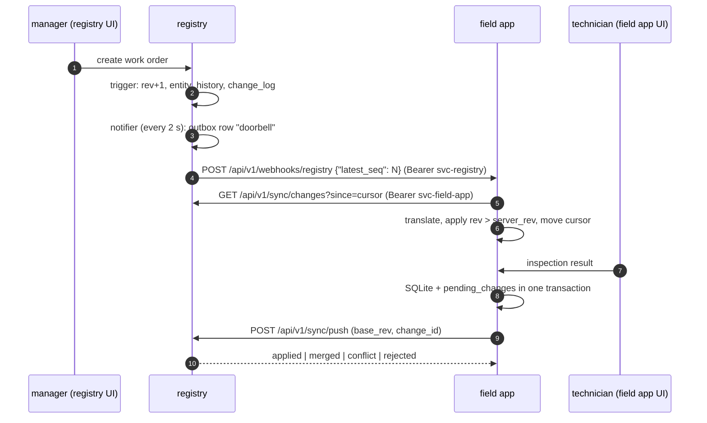

# Two-way sync: registry <-> field app (grade 4.0)

Integration style: **Remote Procedure Invocation** over HTTP/REST. The
registry (System B, PostgreSQL) and the field app (System A, SQLite) do
not share a database or a data model (ADR-007); they integrate only
through the contract below.

Code: `services/registry/src/vigiles_registry/sync/`,
`services/field_app/src/vigiles_field_app/sync/`. Tests:
`tests/unit/test_merge.py`, `tests/unit/test_translator.py`,
`tests/component/test_sync_api.py`, `tests/component/test_conflicts.py`,
`tests/component/test_field_sync.py`, `tests/e2e/test_sync.py`,
`tests/chaos/test_sync_outages.py`.



## Change feed (pull)

`GET /api/v1/sync/changes?since=812&limit=500` (permission `sync:read`):

```json
{"changes": [{"seq": 813, "entity": "work_order", "id": "...", "rev": 3, "op": "update", "data": {"...": "..."}}],
 "next_since": 813, "has_more": false}
```

- Every insert or update of `assets`, `work_orders`, `inspections` and
  `conflicts` is recorded by a trigger in `entity_history` (snapshot per
  revision) and `change_log` (the feed). This includes the importer,
  which writes directly to the database.
- `data` is the snapshot of the entity at that revision. The client keeps
  the highest revision per entity and **skips `rev <= server_rev`**. That
  stops the echo loop: our own change comes back with a revision we
  already know from the push result.
- The field app stores the cursor (`sync_state.registry_since`) in the same
  SQLite transaction as the applied changes, so a crash never skips or
  repeats a page.

## Push

`POST /api/v1/sync/push` (permission `sync:push`):

```json
{"changes": [{"change_id": "...", "entity": "asset", "id": "...", "base_rev": 7,
  "patch": {"condition": "do_naprawy", "notes": "pęknięta masa uszczelniająca"}}]}
```

The patch is in the registry model (the field app translates). Result per
change:

| Status | Meaning |
|---|---|
| `applied {new_rev}` | all fields applied, the registry now equals the client state |
| `merged {new_rev, server_fields}` | applied; the registry also has other changes made meanwhile |
| `conflict {conflict_ids, new_rev}` | at least one shared field changed on both sides; non-conflicting fields applied |
| `rejected {problem}` | invalid field, value, unknown entity or unknown base revision |

Each change runs in its own savepoint, so a rejected change does not undo
the others. The result is stored in `applied_changes` under `change_id`; a
retry of the same change returns the stored result (Idempotent Receiver),
which is what makes at-least-once delivery from the field app safe.

## Three-way merge

In one transaction with `SELECT ... FOR UPDATE` on the entity:

1. `base = entity_history[base_rev]`, `current` = current state,
2. `server_changed` = fields where `current != base`,
   `client_changed` = patch fields where `patch != base`,
3. `overlap` = both changed the field, to different values,
4. overlap is decided by field ownership:
   field-owned -> client wins, office-owned -> server value stays (logged
   as `sync_office_field_kept`), shared -> a row in `conflicts`,
5. remaining patch fields are applied and `rev` increases once.

| Owner | Fields |
|---|---|
| field (technician) | `condition`, `last_inspected_at`, inspections, work order status `w_realizacji` and `zakonczone` |
| office (manager, importer) | `code`, `asset_type`, location, `fire_rating`, `seal_system`, `installed_at`, `installer`, `next_inspection_due`, work order assignment, due date, reason |
| shared (conflict) | `notes` |

There is no last-write-wins anywhere.

### Example (from the plan, covered by `test_plan_example_merge_then_conflict`)

| Step | Who | Change | rev after | Result |
|---|---|---|---|---|
| 1 | - | initial state | 7 | |
| 2 | office | `room: 2.14 -> 2.14A` | 8 | |
| 3 | field, `base_rev 7` | `condition -> do_naprawy`, `notes -> "pęknięta masa"` | 9 | `merged`: disjoint fields |
| 4 | office | `notes -> "do weryfikacji"` | 10 | |
| 5 | field, `base_rev 9` | `notes -> "masa wymieniona"` | 10 | `conflict` on `notes` |

### Resolution

The manager picks the server value, the client value or their own in
`/ui/conflicts` (or `POST /api/v1/conflicts/{id}/resolve`, permission
`conflicts:resolve` - a technician gets 403). The value is written like
any office change and the resolved conflict is itself an entity in the
change feed, so the field app takes the resolved value and removes the
"in conflict" badge.

## Work orders

- registry -> field app: creation, assignment, cancellation,
- field app -> registry: `w_realizacji`, `zakonczone` and the inspection.

An inspection submitted in the field app produces three changes: the
inspection (UUID generated in the field app, so no id mapping is needed),
the asset condition and `last_inspected_at`, and the work order status.

Only one open work order may exist per asset and reason (partial unique
index); `POST /work-orders` returns the existing one with `200`.

## Field app behaviour

| Mechanism | Detail |
|---|---|
| local outbox | `pending_changes`, written in the same SQLite transaction as the local change |
| folding | consecutive edits of an unsent change are merged into it, keeping its `base_rev`, so they do not conflict with each other |
| protected fields | while a local edit is pending or in conflict, older server state does not overwrite that field |
| triggers | webhook "doorbell" from the registry; reconciliation poll every 30 s (a lost doorbell only delays sync) |
| retry | connection errors, timeouts, 5xx, 429, 401: full-jitter backoff (`libs/common/retry.py`); other 4xx: the change is rejected and shown in the sync status |
| offline | "Work offline" stops all calls to the registry; the queue grows and is sent on "Go online" |

Translation (`field_app/sync/translator.py`):

| Registry | Field app |
|---|---|
| `condition`: `sprawny`, `do_naprawy`, `niesprawny`, `wycofany` | `OK`, `NEEDS_REPAIR`, `FAILED`, `RETIRED` |
| `work_orders.status`: `nowe`, `przydzielone`, `w_realizacji`, `zakonczone`, `anulowane` | `NEW`, `ASSIGNED`, `IN_PROGRESS`, `DONE`, `CANCELLED` |
| `building`, `floor`, `room`, `partition` | `label` (read only) |
| `rev` | `server_rev` |

## Doorbell and outbox in the registry

The notifier compares `max(change_log.seq)` with the last announced value
every 2 s and queues a webhook in `outbox` - one pending row at most,
updated during an outage instead of piling up. The relay leases rows with
`FOR UPDATE SKIP LOCKED` and a lease time, sends them with
`Idempotency-Key` and `X-Correlation-ID`, and retries with backoff; after
15 attempts the row is `dead`.

## Authentication (4.0)

`AUTH_MODE=static`: each service client has a bearer token in
`SERVICE_TOKENS` (`.env`). The client name is also its role:
`svc-field-app` may `sync:read` and `sync:push`, `svc-registry` may
`webhook:notify`, `svc-hub` may create work orders and incidents. Missing
or unknown token -> `401` with `WWW-Authenticate: Bearer`, missing
permission -> `403`, both as `application/problem+json`.

UIs use a session; in static mode the login page offers the demo users
(`jan.technik`, `anna.kierownik`, `zarzadca.b1`, `admin`), marked as demo
mode. Managers additionally have `assets:write` (editing asset notes in
the registry UI, needed for scenario S3), which the role table in the
plan did not list.

## Logs and errors

- JSON logs with `correlation_id`; the field app sync cycle sends its ID in
  `X-Correlation-ID`, so one cycle can be followed in both services.
- `integration_events` in the registry: pushed changes and their results,
  kept office fields, created work orders and incidents, resolved conflicts.
- `sync_log` in the field app: every push and pull with its outcome.
- Errors are `application/problem+json`; invalid bodies are `422` with
  field locations; a database outage is `503` with `Retry-After`.

## Known limitations

- A change rejected by the registry stays rejected locally; the field app
  shows it in the sync status but does not roll the local value back. The
  next server change of that entity overwrites it.
- After `merged`, the field app learns the server-side fields from the
  next pull, which runs right after the push in the same cycle.
